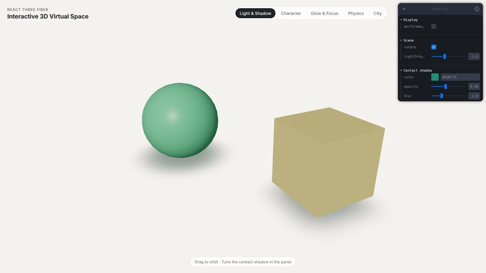
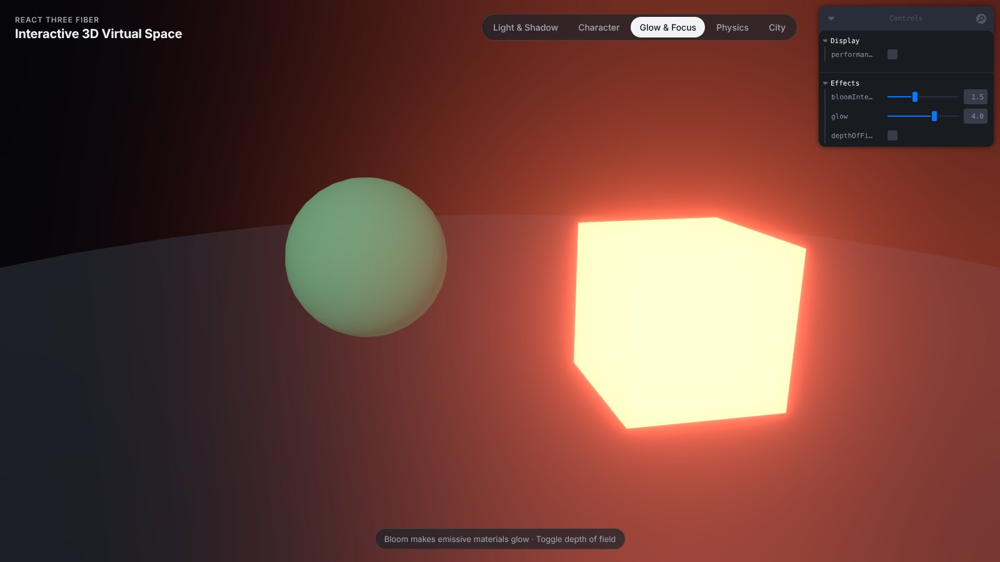
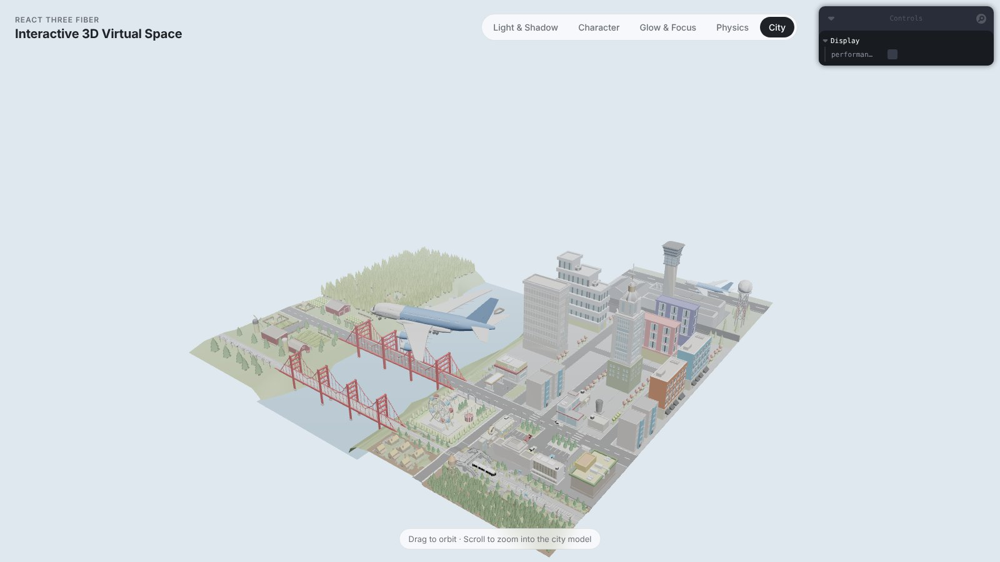
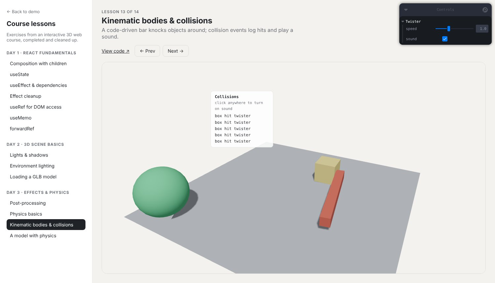

# Interactive 3D Virtual Space

An interactive 3D web experience built with **React Three Fiber** — five small scenes that explore light, animated characters, post-processing effects, real-time physics, and large 3D models in the browser.

**[▶ Live demo](https://paige-han.github.io/Interactive-3D-Virtual-Space/)** · **[📘 Course lessons](https://paige-han.github.io/Interactive-3D-Virtual-Space/lessons.html)**



## Scenes

Switch scenes with the tabs at the top. Each scene has live controls in the panel on the right.

| | |
|---|---|
|  |  |
|  |  |

| Scene | What it shows | Try this |
|---|---|---|
| **Light & Shadow** | Standard materials, ambient + directional light, soft contact shadows | Change the shadow color, blur and opacity |
| **Character** | Loading a rigged GLB model and blending between its animation clips | Switch between Idle, Walk, Run, Fast Run and Jump |
| **Glow & Focus** | Post-processing: bloom on emissive materials and depth of field | Turn up the glow, toggle depth of field |
| **Physics** | Rapier physics: gravity, rigid bodies, impulses, a moving kinematic obstacle | Click the yellow cube to make it jump, change gravity |
| **City** | Loading a large Draco-compressed model and framing it automatically | Orbit and zoom around the city |

## Course lessons

Alongside the demo, a separate **[Lessons page](https://paige-han.github.io/Interactive-3D-Virtual-Space/lessons.html)** walks through the original course exercises one by one — each runnable, with a short explanation and a link to its code.



| Day | Lessons |
|---|---|
| **Day 1 · React fundamentals** | Composition with `children`, `useState`, `useEffect` & dependency arrays, effect cleanup, `useRef`, `useMemo`, `forwardRef` |
| **Day 2 · 3D scene basics** | Lights & three kinds of shadows (real-time, contact, accumulative), environment lighting, loading a GLB model |
| **Day 3 · Effects & physics** | Post-processing (bloom, glitch, noise, vignette, depth of field), physics basics, kinematic bodies & collision events, a character with physics |

## Tech stack

| Area | Tools |
|---|---|
| Framework | React 18, Vite |
| 3D rendering | Three.js, React Three Fiber, drei |
| Effects | @react-three/postprocessing |
| Physics | @react-three/rapier |
| Controls & tooling | Leva (live controls), r3f-perf (performance monitor) |
| Deployment | GitHub Pages via GitHub Actions |

## Project structure

```
index.html                # demo page
lessons.html              # course lessons page
src/
  App.jsx                 # demo: scene tabs, canvas, controls panel
  scenes/                 # the five demo scenes
  lessons/
    LessonsApp.jsx        # lessons viewer (sidebar + live stage)
    registry.js           # list of lessons and their descriptions
    day1/  day2/  day3/   # one file per exercise
public/
  models/                 # robot.glb (animated character), city.glb
  draco/                  # Draco decoder for compressed models
```

## Background

This started as an interactive 3D web course I took in 2023. At the time I uploaded my rough class files as-is — several exercises were unfinished, and some referenced files that never made it into the repo. In 2026 I came back to it: every exercise is now completed, fixed and split into its own file on the Lessons page, and the main concepts are combined into the demo. The original upload is still visible in the commit history.

As a designer, I wanted to understand what it takes to move from static screens to **spatial, interactive experiences** — how light, materials, motion and physics shape what a person feels in a 3D space — and to be able to design those details directly in code.

## Run locally

```bash
npm install
npm run dev
```

Then open the local URL Vite prints (usually http://localhost:5173).
