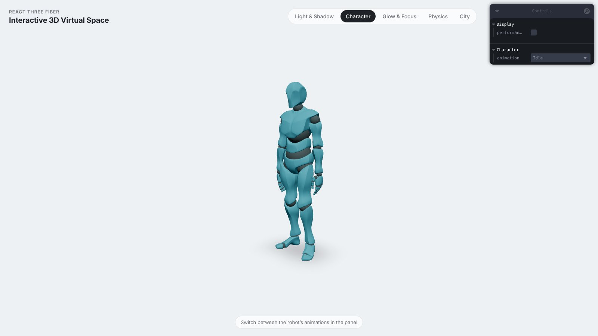
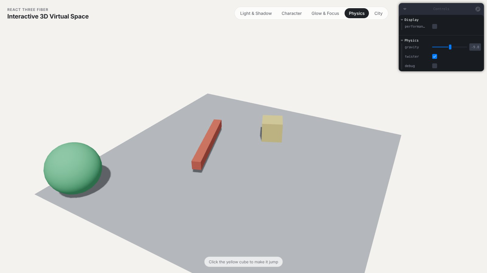

# Interactive 3D Virtual Space

An interactive 3D web experience built with **React Three Fiber**. It explores how light, motion, visual effects and physics can turn a flat web page into a space people can move around in and touch. (2023)

**[▶ Live demo](https://paige-han.github.io/Interactive-3D-Virtual-Space/)** · **[🧩 Building blocks](https://paige-han.github.io/Interactive-3D-Virtual-Space/lessons.html)**


## What I set out to build

| Goal | How it's built |
|---|---|
| **Make objects feel physically present** | Directional + ambient lighting, real-time, contact and accumulative shadows, and image-based lighting from an environment map |
| **Bring designed 3D assets to the web** | GLB models loaded with `useGLTF`, a rigged character blending between animation clips, and a large city model with Draco compression framed automatically |
| **Set mood the way a camera would** | Post-processing: bloom on emissive materials, depth of field, glitch, noise and vignette |
| **Let people touch the scene** | Rapier physics — gravity, rigid bodies and colliders, click-to-jump impulses, a code-driven kinematic obstacle, and collision events with sound |
| **Make it explorable and tunable** | Orbit camera controls, live parameter panels with Leva, and a performance monitor with r3f-perf |

## The demo

Five scenes, switched with the tabs at the top. Each has live controls in the panel on the right.

| | |
|---|---|
|  |  |
|  |  |

| Scene | What it shows | Try this |
|---|---|---|
| **Light & Shadow** | Materials, lighting and soft contact shadows | Change the shadow color, blur and opacity |
| **Character** | A rigged GLB character blending between animation clips | Switch between Idle, Walk, Run, Fast Run and Jump |
| **Glow & Focus** | Bloom on emissive materials and depth of field | Turn up the glow, toggle depth of field |
| **Physics** | Gravity, rigid bodies, impulses and a moving obstacle | Click the yellow cube to make it jump, change gravity |
| **City** | A large Draco-compressed model framed automatically | Orbit and zoom around the city |

## Building blocks

The **[Building blocks page](https://paige-han.github.io/Interactive-3D-Virtual-Space/lessons.html)** breaks the demo down into 14 small, runnable examples — one technique each, with a short explanation and a link to its code.


| Topic | Examples |
|---|---|
| **React foundations** | Composition with `children`, `useState`, `useEffect` & dependency arrays, effect cleanup, `useRef`, `useMemo`, `forwardRef` |
| **Light & materials** | Real-time vs. contact vs. accumulative shadows (with shadow-camera helpers), environment lighting and reflections |
| **3D models** | Loading a GLB model and enabling shadows on its meshes |
| **Visual effects** | Bloom, glitch, noise, vignette and depth of field |
| **Physics & interaction** | Rigid bodies and colliders, impulses, kinematic bodies and collision events, a character dropped into the physics world |

## Tech stack

| Area | Tools |
|---|---|
| Framework | React 18, Vite |
| 3D rendering | Three.js, React Three Fiber, drei |
| Effects | @react-three/postprocessing |
| Physics | @react-three/rapier |
| Controls & tooling | Leva (live controls), r3f-perf (performance monitor) |
| Deployment | GitHub Pages via GitHub Actions |

## Project structure

```
index.html                # demo page
lessons.html              # building blocks page
src/
  App.jsx                 # demo: scene tabs, canvas, controls panel
  scenes/                 # the five demo scenes
  lessons/
    LessonsApp.jsx        # building blocks viewer (sidebar + live stage)
    registry.js           # list of examples and their descriptions
    react/  lighting/  models/  effects/  physics/   # one file per example
public/
  models/                 # robot.glb (animated character), city.glb
  draco/                  # Draco decoder for compressed models
```

## Background

As a designer, I wanted to understand what it takes to move from static screens to **spatial, interactive experiences** — how light, materials, motion and physics shape what a person feels in a 3D space — and to be able to design those details directly in code.

This project began with an interactive 3D web course I took in 2023. I originally uploaded my rough class files as-is; in 2026 I rebuilt them into this runnable demo and a set of focused examples. The original upload is still visible in the commit history.

## Run locally

```bash
npm install
npm run dev
```

Then open the local URL Vite prints (usually http://localhost:5173).
