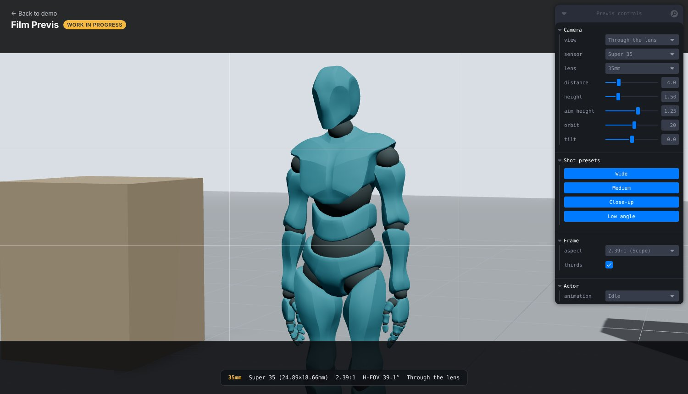
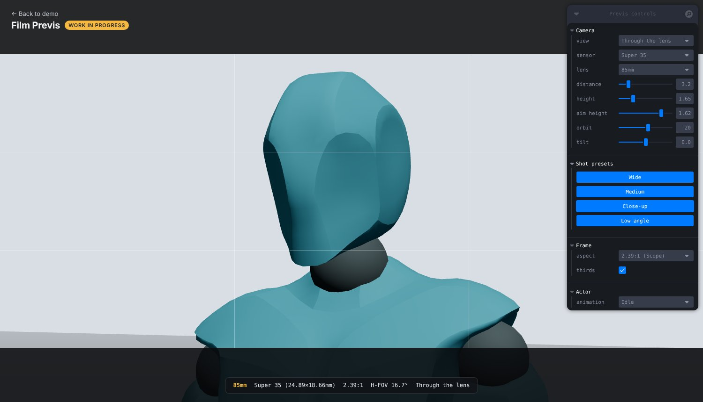
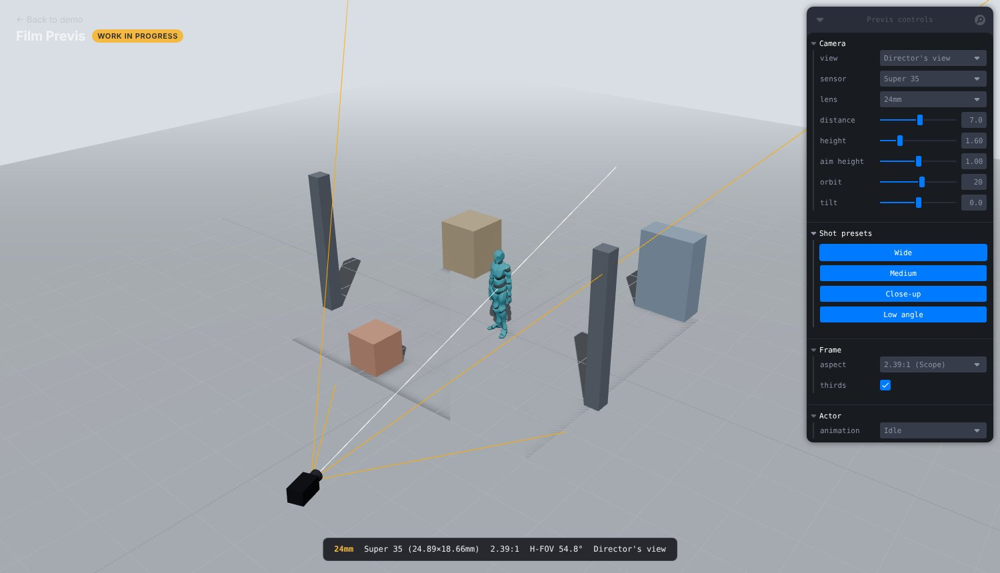
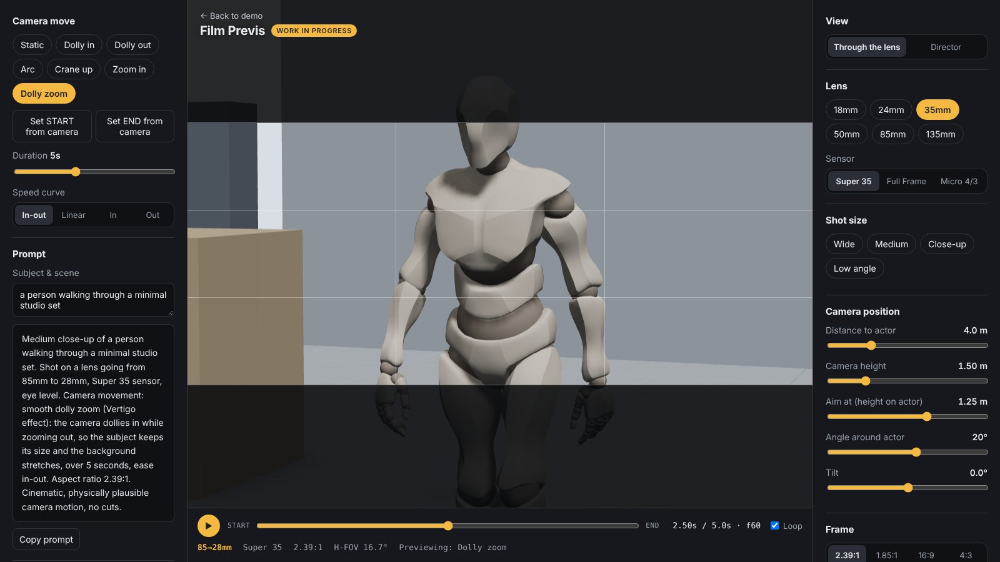
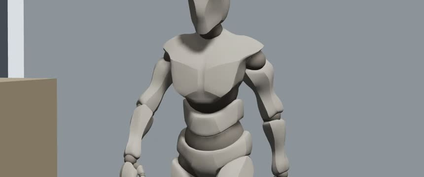
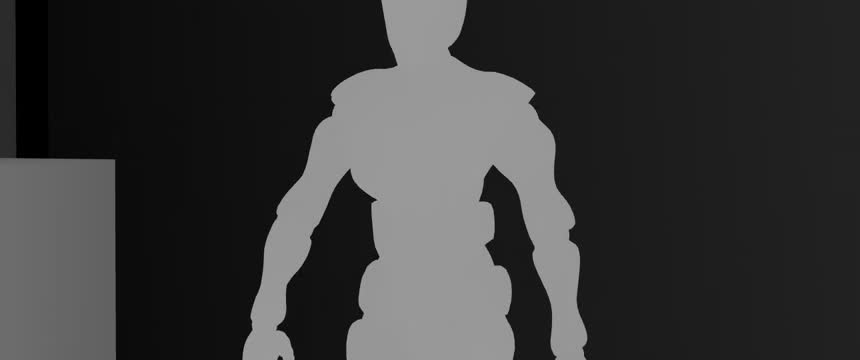
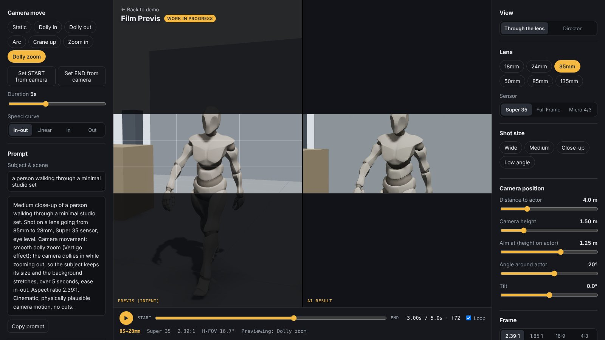

# Film Previs — exploration notes

> Branch: `explore/film-previs` · Status: **work in progress**

## Why

Before moving into design and engineering, I worked on film sets and in TV drama production. On set, I saw how much of a shoot day depends on decisions made beforehand: which lens, where the camera stands, how the actors move through the frame. Those decisions were usually communicated through sketches, reference photos and a lot of explaining — and changing them on the day was expensive.

**Previsualization (previs)** is how crews plan those shots in a rough 3D version of the set. Professional previs usually happens in game engines like Unreal, which takes specialist skills and software that most of the crew doesn't have.

This exploration asks a narrower question: **what would a lightweight, link-shareable shot-planning tool look like if it lived in the browser** — something a director, DP or production designer could open on a laptop or phone without installing anything? As a designer, I'm especially interested in making it speak the crew's language — millimeters, frame lines, shot sizes — rather than 3D-software terms.

## Step 1 — A camera that behaves like a real one ✅



- **Real lenses instead of "zoom."** Pick a focal length (18–135mm) and a sensor (Super 35, Full Frame, Micro 4/3). The field of view is calculated the way it is on set:

  `horizontal angle of view = 2 · atan(sensor width / (2 · focal length))`

  So a 50mm lens on Super 35 frames tighter than the same 50mm on Full Frame — the "crop factor" falls out of the math.
- **Frame lines.** Letterbox masks for 2.39:1, 1.85:1, 16:9 and 4:3, plus a rule-of-thirds grid. The lens math is mapped to the *framed* area, not the browser window, so what's inside the frame lines matches the real lens.
- **Director's view vs. through the lens.** Step outside to see where the camera is standing and what its frustum covers, then look through it.
- **Shot presets.** Wide, Medium, Close-up and Low angle, defined by lens, distance, camera height and aim height on the actor.

| Close-up · 85mm | Director's view |
|---|---|
|  |  |

## Step 2 — Directing AI video with set language ✅

Most AI video tools are a single prompt box. On set, a move is described with a lens, a start frame, an end frame and how the camera travels between them. Step 2 turns the previs camera into a way to **direct** a video model in those terms.



- **Camera moves as start → end.** Dolly in/out, arc, crane up, zoom in and a **dolly zoom** (Vertigo effect), or set your own START and END frames from the camera. Play and scrub the move on a timeline with duration and easing.
- **Prompt written from the shot.** The shot size (wide, medium, close-up…) is *calculated* from the lens, sensor, distance and frame ratio, not typed by hand — the same physics a DP uses to pick a lens. The camera angle and move are described in set terms.
- **A shot package for the model.** One click exports what different video models can take as input:

  | File | Used for |
  |---|---|
  | `prompt.txt` | Text-to-video |
  | `start_frame.png`, `end_frame.png` | Image-to-video and first/last-frame models |
  | `camera_track.json` | Per-frame position, rotation and focal length for camera-controlled models |
  | `previs.webm` | A guide video of the move |
  | `depth.webm` | A linear depth pass for depth-conditioned models |

  | Previs frame | Depth pass |
  |---|---|
  |  |  |

- **Compare intent and result.** Load the generated video and play it side by side with the previs, synced to the same timeline, to judge whether the model followed the move.



**What I learned**
- A dolly zoom is just geometry: keep *distance ÷ focal length* constant and the subject stays the same size while the background stretches.
- Shot sizes can be derived from the lens instead of named by feel, which makes prompts more consistent between shots.
- Browser-recorded WebM files have no duration in their header, which silently breaks players and tools — the export writes it in.

## Roadmap

- [x] Real-lens virtual camera (focal length + sensor size)
- [x] Aspect-ratio frame lines and rule of thirds
- [x] Director's view with visible camera and frustum
- [ ] **Depth of field by f-stop** — focus distance + aperture instead of abstract blur values
- [ ] **Lighting setups** — key / fill / rim presets and a time-of-day sun
- [x] **Camera moves** — dolly, arc, crane, zoom and dolly zoom on a start → end timeline
- [x] **AI video hand-off** — prompt from shot settings, start/end frames, camera track, previs and depth videos
- [x] **Compare** — generated video side by side with the previs intent
- [ ] **Run real models** — test the shot package with several video models and document which inputs each one respects
- [ ] **Shot list** — save camera setups as Shot 1, 2, 3… and export frames as a storyboard
- [ ] **Actor blocking** — mark positions and walk the character along a path
- [ ] **Phone as a virtual camera** — use the device gyroscope to frame shots handheld

## Run it

```bash
npm install
npm run dev
```

Open `/previs.html` on the local URL Vite prints.
